<p align="center">
  
</p>

# DataIntel AI Platform &nbsp; 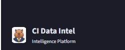 &nbsp; 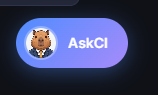

**Enterprise-Grade AI Data Intelligence Agent for Investment Management**

A **LangChain ReAct Agent** that gives financial advisors, client managers, and operations teams direct access to the entire enterprise data warehouse — no technical background required. Ask anything in plain English; the AI agent reasons through the question, queries the right data sources, and delivers formatted answers with interactive visualizations.

> Built with Python · LangChain (ReAct Agent) · Google Gemini · Streamlit · Plotly · SQLite

---

## Why This Exists

Traditional investment firms rely on data engineers and SQL analysts as middlemen — every report request, every data pull, every ad-hoc analysis goes through a technical queue. Financial advisors wait hours or days for answers that should take seconds.

**This platform eliminates that bottleneck.** The LangChain ReAct (Reasoning and Acting) Agent sits on top of the entire data pipeline and gives **any non-technical user** direct analytical power:

- A **financial advisor** asks *"Which clients in Toronto have aggressive risk profiles?"* — the agent reasons through the schema, generates the query, and returns a formatted client list
- A **portfolio manager** asks *"Compare our equity funds against the S&P/TSX benchmark"* — the agent joins across fund and benchmark tables and produces a comparison chart
- An **operations analyst** asks *"Are there any data quality issues today?"* — the agent scans quality scores, anomaly logs, and SLA tracking in one pass
- A **compliance officer** asks *"Which tables contain PII?"* — the agent pulls governance metadata with classification and audit dates

No SQL knowledge. No Jupyter notebooks. No waiting for the data team. Just ask.

**Always-On AI Agent** — The **AskCI** floating button (bottom-right corner, with the capybara mascot icon) gives instant access to the AI agent from anywhere in the platform. One click opens the conversational interface — ask a question, get an answer, without ever leaving your current view. Visible on every page.

<p align="center">
  
</p>

---

## Data Pipeline Architecture

The ReAct Agent has full access to query any layer of this enterprise data pipeline:

<p align="center">
  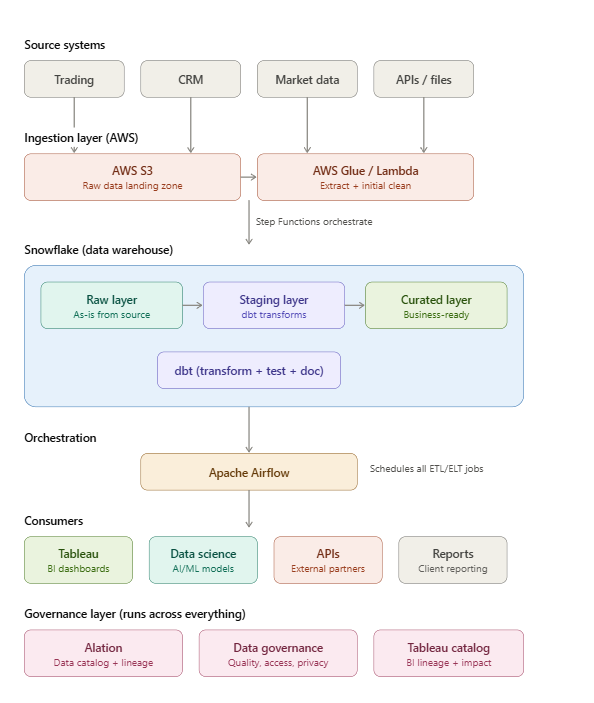
</p>

The agent queries the **Curated Layer** (business-ready tables) via SQL, pulling from funds, clients, transactions, holdings, and benchmarks — all fed by upstream ETL pipelines from Trading, CRM, Portfolio, and Market data sources.

---

## Platform Overview

### Dashboard — Real-Time Intelligence at a Glance

The main dashboard surfaces KPIs, quality scores, anomaly alerts, data lineage, and governance metadata in a single view. No clicking through reports — everything critical is visible immediately.

<p align="center">
  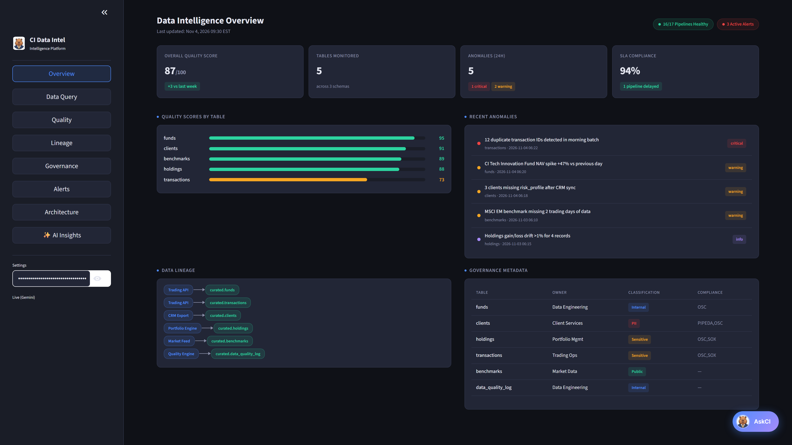
</p>

---

### AI Data Intelligence Agent (LangChain ReAct)

The core of the platform. The **ReAct Agent** (Reasoning and Acting) follows a think → act → observe loop — it reasons about what data the user needs, decides which tables to query and how to join them, executes the SQL, observes the results, and formulates a clear business answer. All in natural language.

**Not a chatbot.** This is a full analytical agent that understands fund structures, client relationships, transaction flows, and benchmark comparisons. It routes questions to the right data source, joins across tables, and formats results for business consumption. Powered by LangChain + Google Gemini with a local fallback engine for zero-downtime reliability.

<p align="center">
  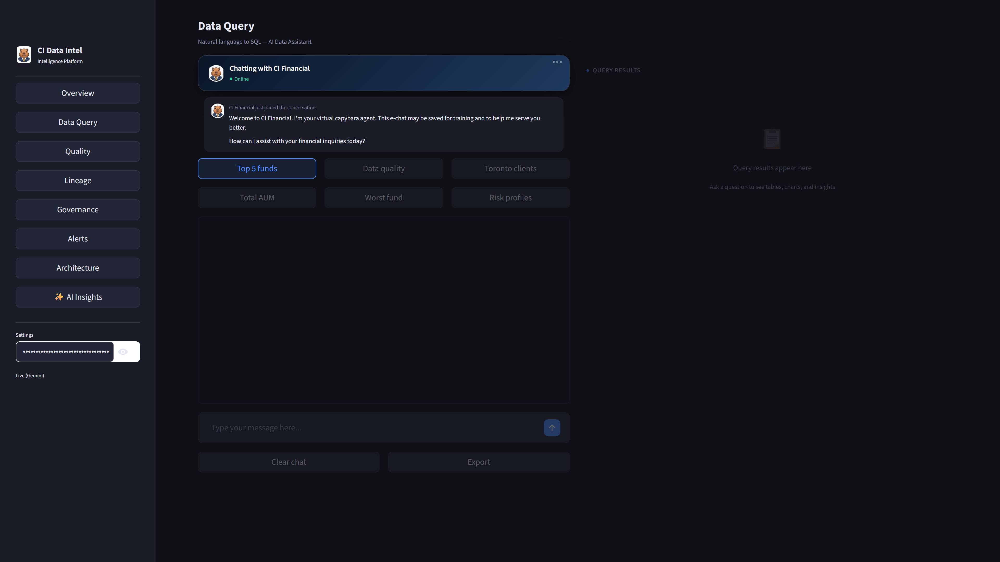
</p>

---

### Data Quality Monitoring

Continuous 4-dimension quality scoring across every table in the warehouse:

- **Completeness** — Null/missing value ratio tracking
- **Accuracy** — Range validation and format verification
- **Timeliness** — Data freshness and SLA compliance
- **Consistency** — Cross-table reconciliation checks

Each table gets a composite score (0–100) with drill-down by dimension. Scores below threshold trigger automated alerts.

<p align="center">
  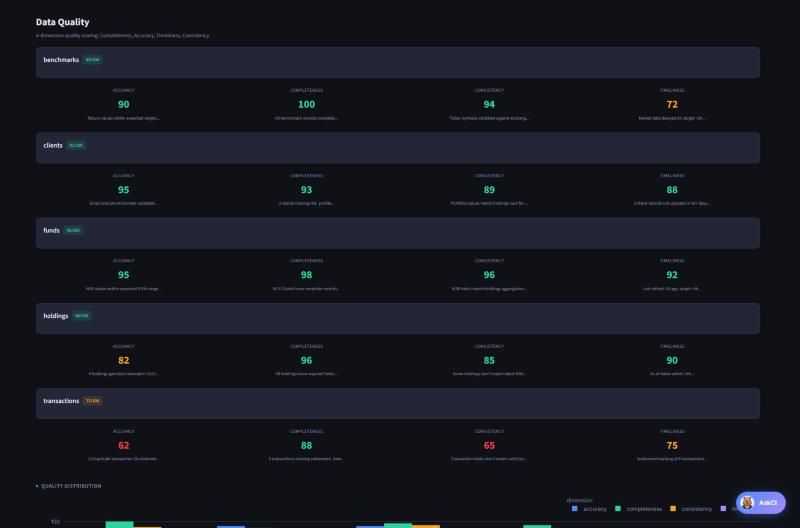
</p>

---

### Data Lineage Visualization

End-to-end pipeline tracing from source systems to curated tables. Interactive flowcharts show every transform step, refresh timestamp, and pipeline health status.

- Trading API → S3 → AWS Glue ETL → curated.funds
- CRM Export → S3 → dbt staging → curated.clients
- Portfolio Engine → S3 → Lambda → curated.holdings
- Market Feed → Lambda → curated.benchmarks

<p align="center">
  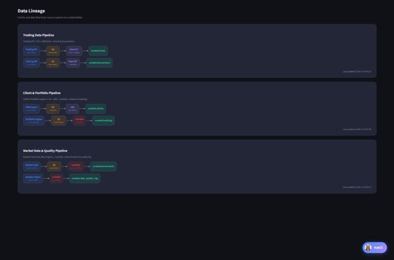
</p>

---

### Data Governance & Compliance

Enterprise metadata management — PII detection, PIPEDA/SOX compliance tracking, access policy classification, and clear team ownership for every data asset.

<p align="center">
  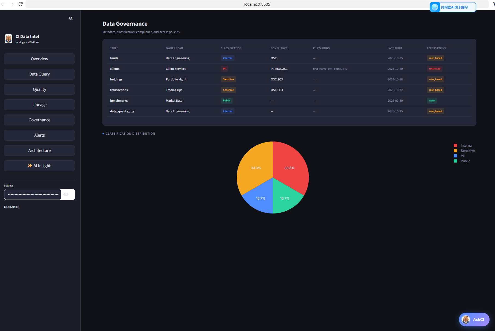
</p>

---

### Real-Time Alert System

Anomaly detection engine with severity-based alerting (Critical / Warning / Info), affected row counts, status tracking (Open → Acknowledged → Resolved), and historical trend analysis.

<p align="center">
  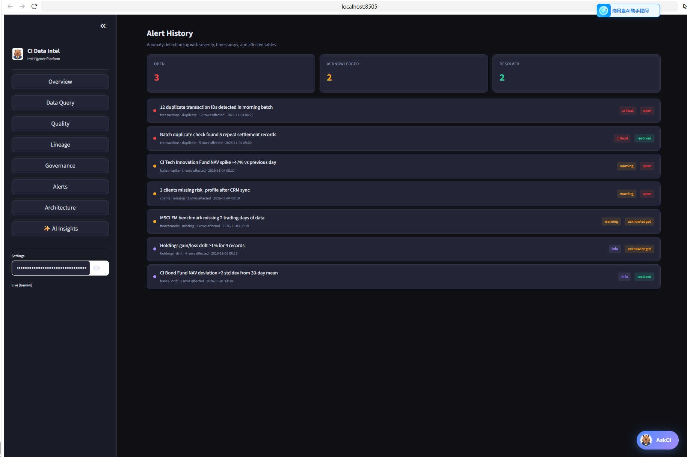
</p>

---

### System Architecture

Full technical architecture visualization — from data sources through ingestion, storage, ETL, the intelligence layer, and the presentation layer.

<p align="center">
  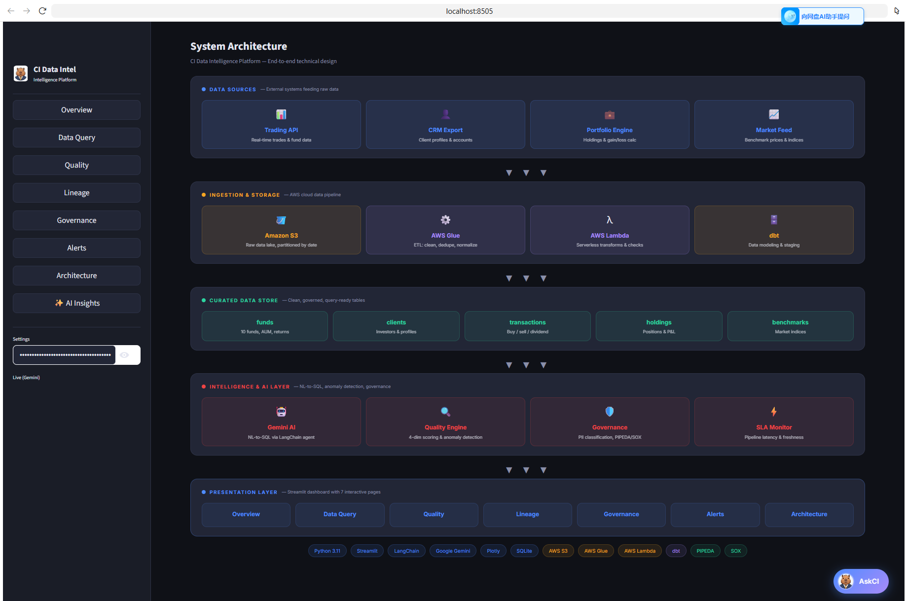
</p>

---

### Quantitative AI Insights Engine

**The AI agent doesn't just answer questions — it thinks like a Jane Street quant analyst.** This module runs institutional-grade analytics that would normally require a quantitative research team: trend decomposition, factor attribution, statistical anomaly detection, and predictive risk modeling — all automated, all in real time.

Inspired by Bloomberg ASKB, BlackRock Aladdin, and Morgan Stanley AI — built to give every team member quant-level analytical power without the quant-level salary.

- **Trend Analysis** — 90-day NAV tracking with AI-detected momentum signals, volatility metrics, and mean-reversion alerts. Identifies regime changes and flags funds diverging from historical patterns.
- **Performance Attribution** — Brinson-style return decomposition into allocation, selection, and currency effects. The AI generates written commentary — the same output a quant analyst would produce for a portfolio review.
- **Anomaly Detection** — Statistical outlier identification across fund returns, transaction volumes, and data quality metrics. Z-score based with configurable sensitivity.
- **Redemption Risk Scoring** — Client-level risk assessment combining portfolio concentration, recent activity, and behavioral signals. Flags high-risk clients before they redeem.

<p align="center">
  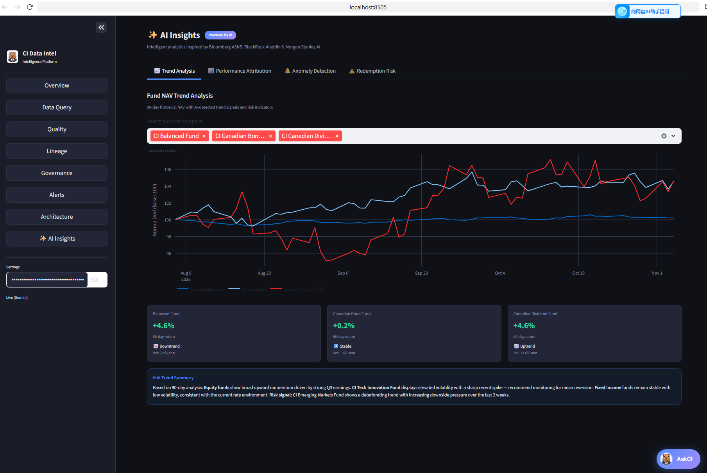
</p>

---

## Architecture

```
┌─────────────────────────────────────────────────────┐
│                   Data Sources                       │
│  Trading API  ·  CRM  ·  Portfolio Engine  ·  Market │
└──────────────────────┬──────────────────────────────┘
                       ▼
┌─────────────────────────────────────────────────────┐
│              Ingestion & Storage (AWS)               │
│     S3 Data Lake  ·  Glue ETL  ·  Lambda  ·  dbt    │
└──────────────────────┬──────────────────────────────┘
                       ▼
┌─────────────────────────────────────────────────────┐
│              Curated Data Store                       │
│  funds · clients · transactions · holdings · benchmarks │
└──────────────────────┬──────────────────────────────┘
                       ▼
┌─────────────────────────────────────────────────────┐
│           Intelligence & AI Layer                    │
│  Gemini Agent · Quality Engine · Governance · SLA    │
└──────────────────────┬──────────────────────────────┘
                       ▼
┌─────────────────────────────────────────────────────┐
│            Presentation Layer (Streamlit)             │
│  Overview · Query · Quality · Lineage · Governance   │
│  Alerts · Architecture · AI Insights                 │
└─────────────────────────────────────────────────────┘
```

---

## Tech Stack

| Layer | Technology |
|-------|-----------|
| AI Engine | LangChain ReAct Agent + Google Gemini (with local NL engine fallback) |
| Frontend | Streamlit (dark theme, responsive layout) |
| Visualization | Plotly (interactive charts, attribution waterfall) |
| Database | SQLite (production-ready schema, swappable to Snowflake/BigQuery) |
| Data Modeling | dbt-compatible curated layer design |
| Cloud Design | AWS (S3, Glue, Lambda) pipeline architecture |
| Compliance | PIPEDA, SOX framework integration |

---

## Quick Start

```bash
# Clone the repository
git clone https://github.com/rachel609/DataIntel-AI-Platform.git
cd DataIntel-AI-Platform

# Install dependencies
pip install -r requirements.txt

# Run the platform (works immediately in demo mode — no API key needed)
streamlit run app.py
```

**Demo Mode**: Runs fully functional with mock investment data out of the box. All 8 dashboard pages, the AI agent, and analytics modules work without any API key.

**Live Mode**: Add your Gemini API key in the sidebar to enable the full LangChain + Gemini agent for unrestricted natural language queries.

---

## Project Structure

```
├── app.py              # Main application — 8-page Streamlit dashboard
├── agent.py            # AI agent — LangChain + Gemini integration
├── nl_engine.py        # Local NL engine — zero-API-dependency query generation
├── mock_data.py        # Data layer — schema definition + mock data generation
├── icon.png            # Application icon
├── screenshots/        # Platform screenshots
└── requirements.txt    # Python dependencies
```

---

## License

MIT
